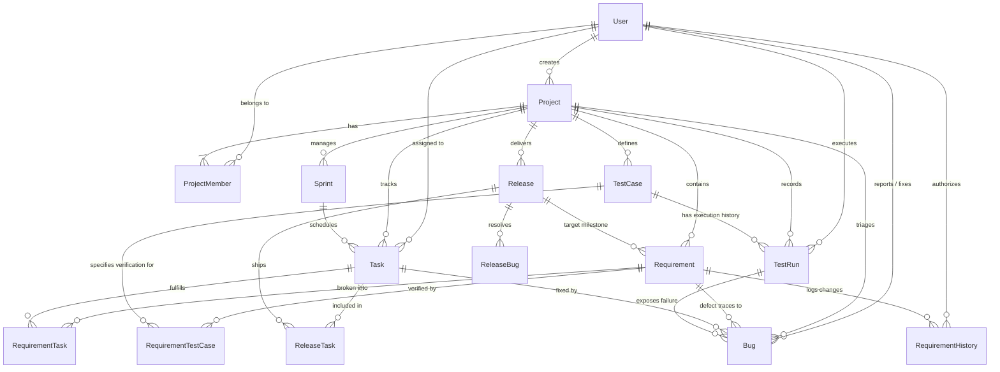

# DevTrack — Architecture Document

## 1. System Overview
DevTrack is architected as a **Modular Monolith** designed for high auditability, deterministic traceability, and clean operational simplicity.

```
+--------------------------------------------------------------------------+
|                       DevTrack Web Client (SPA)                         |
|   Tailwind CSS (Dark Theme) + Client-Side Hash Router + Modular Views   |
|   Components: Dashboard, MoSCoW Reqs, Kanban Board, QA Runs, Bugs, Rels |
+--------------------------------------------------------------------------+
                                     |
                                     | REST JSON / State Engine
                                     v
+--------------------------------------------------------------------------+
|                       Modular State & Persistence                        |
|   - LocalStorage Reactive Store (Browser Offline / Instant Execution)    |
|   - REST API v1 Specification (/api/v1/projects, /requirements, etc.)   |
|   - Prisma ORM Data Access Layer (PostgreSQL 16)                         |
+--------------------------------------------------------------------------+
                                     |
                                     | SQL Relational Model
                                     v
+--------------------------------------------------------------------------+
|                       PostgreSQL 16 Storage Engine                       |
|   Relational Integrity, Cascades, Foreign Keys, Append-Only Audit Logs   |
+--------------------------------------------------------------------------+
```

---

## 2. Entity-Relationship (ER) Diagram

The following Mermaid diagram represents the complete relational schema defined in `prisma/schema.prisma`:



---

## 3. Data Flow Architecture

### 3.1 Traceability Chain Flow
The central data flow guarantees that every production code cut has a direct lineage tracing back to user elicitation:

1. **Elicitation:** A `Requirement` is authored, prioritized (*Must Have*), and approved.
2. **Implementation:** Tasks are created on the `Sprint` Kanban board, linked via `RequirementTask`.
3. **Verification:** A `TestCase` is authored linked via `RequirementTestCase`. When run, an immutable `TestRun` record is saved.
4. **Defect Remediation:** If the `TestRun` status is `Failed`, a linked `Bug` is generated preserving `relatedTestRunId`.
5. **Release Promotion:** The `Release` gate queries all linked items. If all test runs are `Passed` and open blockers $= 0$, the release status transitions to `Released`.

---

## 4. Key Technology Choices & Trade-offs

| Component | Selected Technology | Rationale & Trade-offs |
| :--- | :--- | :--- |
| **Styling & Design** | Tailwind CSS + Google Fonts (Geist/Inter/JetBrains Mono) | Exact replication of Google Stitch project design tokens with zero bundle bloat and unified dark palette. |
| **Frontend Routing** | Modular Client-Side Router | Fast hash-based navigation (`#/dashboard`, `#/requirements`) that works seamlessly in local dev, static file preview, and containerized preview without complex server URL rewrites. |
| **Database ORM** | Prisma ORM | Strongly typed data access, declarative migration management, and strict schema validation preventing invalid enum states. |
| **Container Engine** | Docker Compose v2.28 | Standardized local development matching staging containerization with PostgreSQL 16 healthchecks. |
| **Testing Architecture** | Vitest + Supertest | Rapid execution, built-in ESM support, and isolated unit test execution. |
